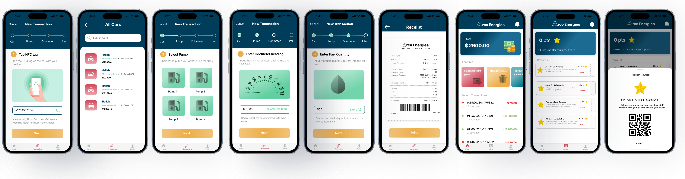

<div align="center">

# ⛽ Arco Energies

### Fuel Station Management & Customer Loyalty System

**Flutter · Dart · Java · Spring Boot · MongoDB · NFC · REST APIs**

[](https://flutter.dev/)
[](https://dart.dev/)
[](https://spring.io/projects/spring-boot)
[](https://www.mongodb.com/)

**[📱 Flutter Frontend](https://github.com/janassaadeh/arco-energies/tree/frontend)** · **[⚙️ Spring Boot Backend](https://github.com/janassaadeh/arco-energies/tree/backend)**

</div>

---

## ✨ Overview

**Arco Energies** is a full-stack fuel station management and customer loyalty application developed for a real client in Lebanon. The system supports fuel-station operations and loyalty workflows through a **Flutter mobile application** and a **Spring Boot backend**.

The application supports different operational roles—**administrators, operators, and customers**—and brings together fuel transaction recording, **NFC-based interactions**, and customer rewards in one solution.

> **Project status:** Completed and delivered client project. The application was not adopted for day-to-day production use. This repository documents the delivered implementation as a portfolio project.

## 🚀 Key Features

### ⛽ Fuel Transaction Management
- Record fuel transactions and associated operational details.
- Capture **pump information, vehicle odometer readings, and fuel quantity**.
- Support receipt-printing workflows.

### 📲 NFC & Loyalty Workflows
- Integrate NFC capabilities into fuel-station workflows.
- Connect transaction activity with backend-managed customer rewards.
- Support reward redemption through backend services.

### 👥 Role-Based Workflows
- Support distinct **admin, operator, and customer** experiences.
- Connect user-facing functionality to backend APIs and role-based security.

### 🔗 Mobile–Backend Integration
- Flutter mobile client integrated with a Java/Spring Boot backend.
- REST API communication for data exchange and business operations.
- MongoDB persistence for backend application data.

## 🧰 Technology Stack

| Layer | Technologies |
|---|---|
| Mobile app | Flutter, Dart |
| App state | Provider |
| API communication | Dio, REST APIs |
| Mobile integrations | `flutter_nfc_kit`, `qr_code_scanner`, Firebase Messaging |
| Backend | Java 17, Spring Boot 3.2.2 |
| Database | MongoDB |
| Backend security | Spring Security, JWT |
| Other backend tooling | Maven, Dockerfile |

The frontend dependencies also include `shared_preferences`, `local_auth`, and UI utility packages. The backend includes Firebase Admin dependencies.

## 🏗️ Repository Organization

This repository separates the Flutter mobile app and Spring Boot backend into **two Git branches**:

| Branch | Contents | Explore |
|---|---|---|
| `frontend` | Flutter project (`lib/`, `android/`, `ios/`, `assets/`) | [View frontend](https://github.com/janassaadeh/arco-energies/tree/frontend) |
| `backend` | Spring Boot Maven project in `demo/` | [View backend](https://github.com/janassaadeh/arco-energies/tree/backend/demo) |

**Frontend organization** (as found in the repository):

```text
lib/
├── Models/
├── Provider/
├── Screens/
├── Services/
├── Widgets/
└── main.dart
```

**Backend structure:** a Maven-based Spring Boot service under `demo/`, with Java source in `demo/src/main/java` and resources in `demo/src/main/resources`.

> This project does **not** claim to use Clean Architecture. The structure above reflects the actual published repository.

## 🔄 Example Business Workflow

A typical fuel transaction involves an operator recording fuel details in the mobile app, interacting with an NFC-enabled workflow, and communicating with the backend to persist the operation and manage applicable loyalty rewards.

This is a high-level illustration of the implemented workflow; specific steps and permissions depend on the user role and application configuration.

## 📸 Application Screenshots

 

## ⚙️ Local Setup

### Flutter frontend

```bash
git clone --branch frontend https://github.com/janassaadeh/arco-energies.git
cd arco-energies
flutter pub get
flutter run
```

### Spring Boot backend

```bash
git clone --branch backend https://github.com/janassaadeh/arco-energies.git
cd arco-energies/demo
./mvnw spring-boot:run
```

On Windows, use `mvnw.cmd spring-boot:run` instead.

**Configuration required:** Backend MongoDB connection, authentication/secret settings, Firebase-related configuration, and the frontend API base URL must be set up for the intended environment. NFC features also require compatible hardware and permissions. The commands above require those dependencies to be configured before the application can run successfully.

## 💡 Engineering Highlights

- Built a **real-client** Flutter and Spring Boot system spanning mobile and backend development.
- Integrated **NFC** with fuel transaction and customer loyalty workflows.
- Supported **admin, operator, and customer** business roles.
- Used **MongoDB** to persist backend data and REST APIs to connect app features.
- Implemented practical features oriented toward fuel-station operations rather than a purely illustrative demo.

## 👩‍💻 Developer

**Jana Saadeh** — Flutter Developer | Mobile Software Engineer

[Portfolio](https://janasaadeh.com/) · [GitHub](https://github.com/janassaadeh) · [LinkedIn](https://www.linkedin.com/in/jana-saadeh-123j/)

---

*A completed client delivery combining Flutter, NFC integration, and Spring Boot business workflows.*
